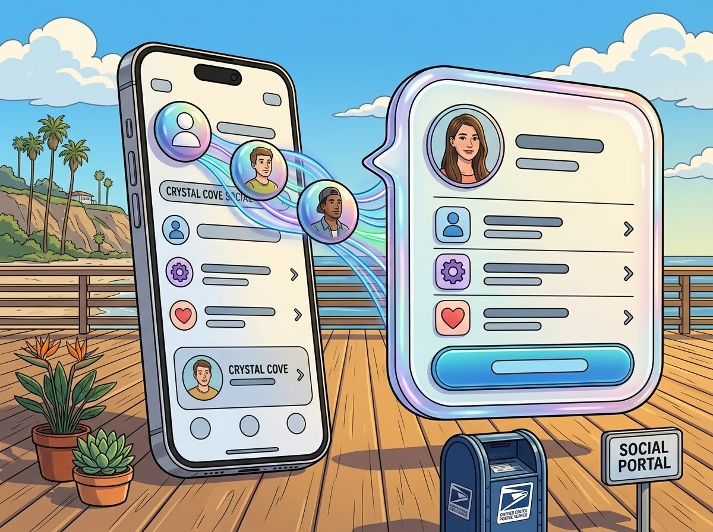

# TiAnchoredPresentation

<picture>
  <source media="(prefers-color-scheme: dark)" srcset="assets/ti-anchoredpresentation-hero-dark.jpg">
  <source media="(prefers-color-scheme: light)" srcset="assets/ti-anchoredpresentation-hero-light.jpg">
  
</picture>

`ti.anchoredpresentation` presents native action sheets and custom-content popovers from Titanium views, buttons, navigation bar buttons, and toolbar items.

Version **1.1.0**, with pass-through touches, native popover background colors, support for visible anchors beneath undimmed sheets, optional manual scroll-inset control, native zoom, and an iOS 26+ deployment target. Requires Titanium SDK 13.4.1+ and Xcode 26+. UIKit controls the presentation animation, material, arrows, and dismissal. `isMorphingSupported()` returns true on every supported OS; it does not guarantee that every custom source has the same animation.

## Installation

Download the module ZIP from the [GitHub releases](https://github.com/designbymind/TiAnchoredPresentation/releases), install it into your Titanium support directory, and add:

```xml
<modules>
  <module platform="iphone" version="1.1.0">ti.anchoredpresentation</module>
</modules>
```

When upgrading from an earlier version, install 1.1.0 and update the module version in your app. If replacing a development build that already uses 1.1.0, clean and rebuild the app so it links the new native binary.

Set your app's minimum iOS version to 26 or later with `<ios><min-ios-ver>26.0</min-ios-ver></ios>` in `tiapp.xml` (merge into the existing `<ios>` section). See [Classic example](example/app.js) and [Alloy example](example/alloy/).

## Action sheets

```js
const Anchored = require('ti.anchoredpresentation');
const confirmation = Anchored.createActionSheet({
    title: 'Delete recent items?',
    actions: [{ id: 'delete', title: 'Delete all', style: 'destructive' }]
});
confirmation.addEventListener('click', e => {
    if (e.id === 'delete') clearRecentItems();
});
confirmation.show({ sourceView: clearButton });
```

Properties: `title`, `message`, `actions`, `sourceView`, `arrowDirections`, `dismissOnOutsideTap` (default true).

Each action has `title` (required), a unique string `id` (defaults to its index as a string), `style` (`default`, `destructive`, or `cancel`), and `enabled` (default true). Only one cancel action is permitted. UIKit hides the cancel button when presenting an anchored popover; outside dismissal is delivered through `dismiss`.

## Custom content

```js
const content = Ti.UI.createView({ width: Ti.UI.FILL, height: Ti.UI.FILL });
content.add(Ti.UI.createLabel({ text: 'Your own Titanium content' }));
const popover = Anchored.createPopover({ contentView: content, width: 300, height: 240 });
popover.show({ sourceView: infoButton });
popover.setContentSize({ width: 300, height: 320 });
popover.hide();
```

Use a dedicated, unattached view tree as `contentView`. Its children can include buttons, labels, images, scroll views, TableViews, ListViews, and other view proxies. Windows and NavigationWindows are not content views. The root should normally use `Ti.UI.FILL`; its container size is supplied by the popover's numeric `width` and `height` in points (defaults 320 × 240). UIKit may constrain the requested size to available space. UIKit supplies the native background and chrome; opaque content backgrounds can obscure the system material.

Custom content stays in a popover on compact-width iPhone layouts. The proxy forwards Titanium view open/close lifecycle notifications and lays out content as UIKit changes bounds. The same presentation proxy can be shown again after dismissal. Content can be updated through ordinary Titanium APIs; replace `contentView` only while hidden.

## Popover background color

Set `backgroundColor` on the presentation to request a native backdrop color, including the arrow when UIKit displays one:

```js
const popover = Anchored.createPopover({
    contentView: tutorialContent,
    width: 300,
    height: 88,
    backgroundColor: '#007AFF'
});
```

Titanium color strings and semantic color names are accepted. Omit the property or set it to `null` to use UIKit's default. The value is converted and applied on each `show()`; change it while hidden. Invalid colors throw `invalid_background_color` before presentation begins.

In Alloy, a color already supplied by TSS can be reused with `backgroundColor: $.content.backgroundColor`. This colors the native popover backdrop rather than the screen dimming overlay, and does not overwrite backgrounds on your content views. Keep content backgrounds transparent, or give them the same color, for a consistent appearance. UIKit still controls the material, opacity, and final arrow/chrome rendering; this option does not add a custom background view or promise a flat opaque fill. Anchored action sheets can use the same backdrop option where UIKit presents them as popovers, but UIKit owns their action-row styling.

## Pass-through touches

Set `passthroughViews` to an array of ordinary Titanium views or buttons that should remain interactive while the popover is visible:

```js
const popover = Anchored.createPopover({
    contentView: tutorialContent,
    width: 300,
    height: 88,
    passthroughViews: [aiButton]
});
popover.show({ sourceView: aiButton });
```

Omit the property or use `[]` to keep outside views blocked by the popover. UIKit delivers touches to the listed views; their handlers can explicitly call `hide()` when appropriate. This does not bypass a dimmed sheet or another blocking modal.

The property is read and native views are resolved on every `show()`. Change the list while hidden and supply current proxies when replacing views. Each entry must be a visible view in the source window; detached/hidden views, non-view values, and navigation/toolbar bar items are rejected before presentation. A visible ordinary Button, ImageView, or container View is supported. Passing a container also permits interaction with its descendants. The same configuration is available for anchored action sheets where UIKit presents them as popovers.

## Native presentation from a button, image, or avatar view

```js
const bubble = Anchored.createPopover({
    contentView: profilePreview,
    width: 300,
    height: 240
});
avatar.addEventListener('click', () => bubble.show({ sourceView: avatar }));
```

A toolbar is not required to anchor custom content. `avatar` can be a visible ordinary View or ImageView; ordinary Button proxies also work. Omit `sourceRect` to use the entire source item. Leave `arrowDirections` unset to use UIKit's default (`any`). UIKit chooses the source-specific transition and material; an ordinary image/view is not guaranteed the same morph as a glass bar button.

`arrowDirections: 0` directly requests UIKit's arrowless popover. It is not an animated bubble mode: a standalone UIKit test on iOS 27.0 reproduced an abrupt entrance from an ordinary button, while the standard toolbar item continued animating its separate glass chrome. Use the default arrow setting when native animation is the priority. The module supplies no replacement animator, custom chrome, or glass workaround. The Classic and Alloy examples use the default setting.

## Native zoom transition (iOS 26+)

```js
const bubble = Anchored.createPopover({
    contentView: profilePreview,
    width: 300,
    height: 240,
    transition: 'zoom'
});
bubble.show({ sourceView: avatar });
```

`transition` accepts `'system'` (default) or `'zoom'`. Zoom is supported only for custom-content popovers, not action sheets. The option requests UIKit's `UIViewController.preferredTransition` with a source-view provider for ordinary views/buttons or a source-bar-button-item provider for toolbar/navigation items. It does not install a custom animator, SwiftUI host, content fade, or replacement glass background. Leave arrow directions at their default; zoom is independent of the arrow setting.

UIKit treats this as a preference and can select a different transition for the presentation context or accessibility settings. An ordinary avatar need not have the same glass appearance as a glass-styled control. Providers re-resolve the current visible source for presentation/dismissal and return nil if it is detached or hidden; UIKit handles its fallback. Keep sources attached for the best result. `dismissOnOutsideTap: false` also prevents the zoom gesture from beginning, while programmatic `hide()` remains available.

Configuration is read at `show()`. Change `transition` while hidden. A live `setSourceView()` updates the anchor and preferred transition; switching source kinds during an active interactive gesture is outside the supported usage. The Classic and Alloy examples request zoom; remove that property to compare the default system presentation.

## Manual scroll insets

`createPopover({ ..., autoAdjustScrollViewInsets: false })` disables UIKit safe-area additions to the content insets of contained UIScrollViews, including TableView/ListView/ScrollView. The default is false: your explicit content insets are used without UIKit safe-area additions. Set true to preserve each view's existing native inset policy. The option is read at show; change it while hidden.

```js
const bubble = Anchored.createPopover({
    contentView: content,
    width: 300,
    height: 360,
    transition: 'zoom',
    autoAdjustScrollViewInsets: false
});
bubble.addEventListener('show', () => {
    table.setContentInsets({ top: 52, bottom: 80, left: 0, right: 0 });
    table.setContentOffset({ x: 0, y: -52 }, { animated: false });
});
```

The `contentInsets` property assignment was also verified on SDK 13.4.1.GA; examples use the documented `setContentInsets()` method.

Titanium's `setContentInsets()` applies to the current native table. Reapply it when presenting reused content, as in the example.

The module uses UIKit's `contentInsetAdjustmentBehavior = .never`, without changing your contentInset or contentOffset. It applies the policy to scroll views added during layout, and restores their original policy after completed dismissal so reused content is not permanently modified. It does not remove explicit table headers/section padding, layout offsets, your own top inset, or UIKit's normal scrolling/bounds clamping.

At the top, a 52-point top inset intentionally creates 52 points of space in the table's scrolling content. For a header overlay of height 52, position the TableView at top 0 and use that inset to clear the overlay. If the TableView is already positioned below the header, adding another 52-point inset reserves the header space again. See [manual-inset example](example/manualInsets.js).

## Shared API

- `show({ sourceView, sourceRect?, animated? })`: show from a visible source. `animated` defaults true. A configured `sourceView` can be used instead. Repeated show calls while visible/transitioning are ignored. A new presentation may start from the dismiss event, after UIKit has detached the prior controller.
- `hide({ animated? })`: dismiss programmatically. Safe while already hidden; a hide during opening waits for presentation completion.
- `setSourceView(view)`: change the source, including while visible, within the same presenting controller. Clears any sub-rectangle anchor.
- `setContentSize({ width, height })`: resize a custom-content popover or configure its next presentation.
- `isMorphingSupported()`: retained module method; always true for supported iOS 26+ deployments.

`sourceView` accepts any visible `TiViewProxy` with a native view. Navigation/toolbar sources preserve an already attached `UIBarButtonItem`. The resolver never creates a bar item for an ordinary view. Views hidden behind another modal controller, detached/recycled views, invisible sources, and non-view objects are rejected. A source in the presenting content beneath a sheet is allowed while the sheet is at or below its configured `largestUndimmedDetentIdentifier` and does not cover the source center. The sheet remains the presentation owner; it is not dismissed or reparented. Keep the source alive and attached through dismissal.

`sourceRect` is optional `{ x, y, width, height }` in the normal source view's coordinates. Omit it to anchor to the full source item. Sub-rectangles are not supported for bar-item sources. `arrowDirections` is a bitmask: none=0, up=1, down=2, left=4, right=8, any=15 (default). UIKit decides the final placement and animation.

Configuration properties are read at `show()`. Use the explicit methods for live size/source changes; direct property changes apply to the next presentation. `dismissOnOutsideTap: false` prevents outside-tap dismissal and adaptive interactive dismissal; provide a close button that calls `hide()`.

Events:

- `show`: presentation completed; `{ sourceKind: 'view' | 'barButtonItem' }`.
- `click`: action sheet selection after dismissal; `{ id, index, title, style, enabled }`. Index refers to the original configured action array.
- `dismiss`: emitted once after cleanup; `{ reason: 'action' | 'cancel' | 'outside' | 'programmatic' | 'error' }`.

Source/content validation errors throw a Titanium exception. This module uses public UIKit APIs, with no custom animator or SwiftUI dependency. Arbitrary destination-window zoom transitions remain in [TiZoomTransition](https://github.com/designbymind/TiZoomTransition).

## Validation

See [validation notes](documentation/validation.md) for compile/package results and the device interaction checklist. Compilation alone does not prove the precise morphing appearance for every source type.

## License

MIT. Local TiZoomTransition and ti.popover were studied as bridge/lifecycle references; the implementation uses new Objective-C code and Titanium's generated module scaffold.
